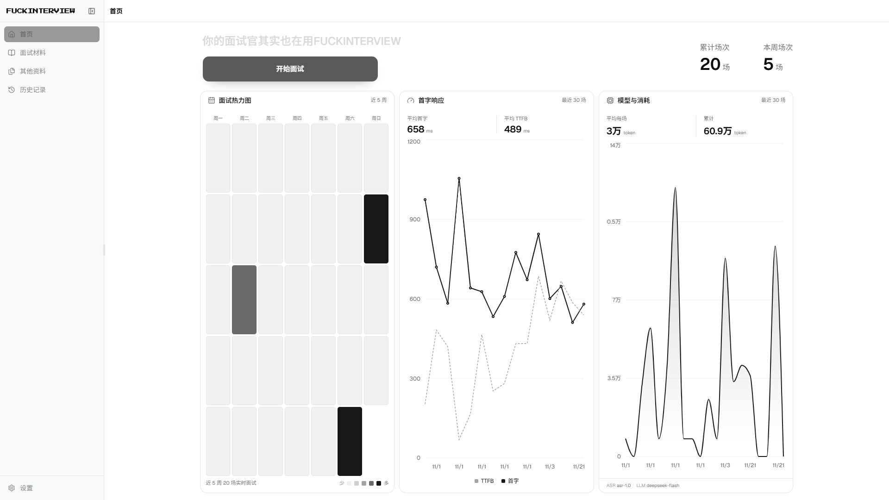
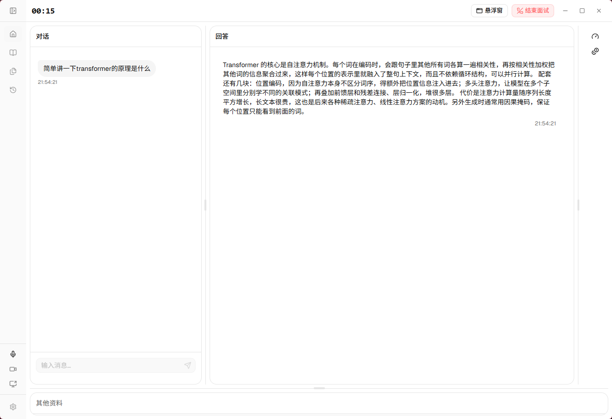
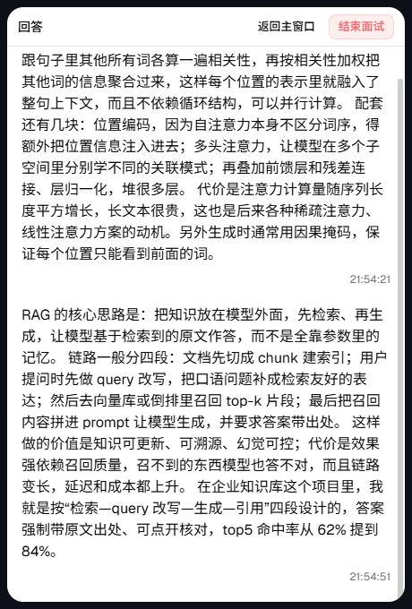

<p align="center">
  
</p>

<h1 align="center">FUCKINTERVIEW</h1>

<p align="center">
  Live voice interview assistant: it hears the interviewer's question and turns it into an answer you can say out loud.
</p>

<p align="center">
  <strong>English</strong> · <a href="README.md">简体中文</a>
</p>

<p align="center">
  
  
  
  
  <a href="LICENSE"></a>
</p>

---

FUCKINTERVIEW is a desktop interview assistant that runs entirely on your machine. It captures the interviewer's questions from system audio, transcribes them, and answers from your own resume, experience cards, question bank and glossary — showing the answer as text in real time. Data, models and API keys never leave your computer.

## Screenshots

| Home | Live interview | Floating window |
| :---: | :---: | :---: |
|  |  |  |

## What it does

- **Hears the question** — captures the interviewer from Windows loopback audio (no cooperation needed), segments the speech and transcribes it; the glossary fixes homophones and aliases.
- **Answers from your material** — experience facts come only from your resume and experience cards; nothing gets invented. Principles, designs and concepts get a straight answer from the model's own knowledge.
- **Prepared answers come out verbatim** — a question bank hit skips the model entirely, and the same line is never pasted twice.
- **Every question in a question** — several questions in one breath all get answered, in order; a rapid follow-up is merged with the previous one inside a 6-second window.
- **Floating window** — pull the answers into an always-on-top window while the main window hides, so screen sharing only shows the small one.
- **Screen-capture protection** — the windows can be excluded from system-level capture, following the setting.

## How it works

```text
System audio ─► ASR ─► term fix ─┬─► question bank hit ─► verbatim answer
                                 └─► prompt ─► LLM ─► text answer
Resume / cards / question bank / glossary ──────────────────────────┘
```

## Install

### Windows installer

Download the latest `FUCKINTERVIEW-Setup-<version>.exe` from [Releases](https://github.com/hu-qi-jia/FUCKINTERVIEW/releases) and run it. If there is no release yet, build from source below.

On first launch you pick a **data folder** and a **model folder** (both skippable, changeable later in Settings → General). Then open Settings → Models, fill in the ASR / LLM API keys and you are ready.

- Data lives in `%APPDATA%\FUCKINTERVIEW\data` by default and survives uninstall
- Live interviews rely on Windows loopback audio, so Windows 10 2004 or newer
- Upgrading from the old “面试语音助手”: the first launch copies the old data over, the old folder is kept

### Run from source

Requires Python 3.11+ and Node.js 20+:

```bash
git clone https://github.com/hu-qi-jia/FUCKINTERVIEW.git
cd FUCKINTERVIEW

python -m venv .venv
.venv/Scripts/python -m pip install -r requirements.txt

npm --prefix web/client install
npm --prefix web/client run build

npm --prefix desktop install
npm --prefix desktop start
```

Browser only (no desktop shell):

```bash
PYTHONUTF8=1 PYTHONIOENCODING=utf-8 .venv/Scripts/python.exe server.py
```

Then open <http://localhost:7860/>. On macOS / Linux use `.venv/bin/python` instead.

Build the Windows installer yourself:

```bash
npm --prefix desktop run dist
```

The result lands in `desktop/dist/FUCKINTERVIEW-Setup-<version>.exe`.

## Tech stack

| Layer | Choice |
| --- | --- |
| Desktop | Electron 44 (frameless window, tray, system audio loopback, capture protection) |
| Frontend | React 19 · TypeScript · Vite · Tailwind CSS · Pipecat React SDK |
| Backend | Python 3.12 · FastAPI · Pipecat voice pipeline (SmallWebRTC transport) |
| Speech | Silero VAD · Smart Turn v3 (local ONNX inference) |
| Models | ASR: Qwen / MiniMax / Deepgram / OpenAI Whisper<br />LLM: any OpenAI-compatible endpoint / Qwen / Anthropic |
| Retrieval | SQLite FTS5 + `BAAI/bge-small-zh-v1.5` embeddings (ONNX, no PyTorch) |

## License

[MIT](LICENSE) © 2026 hu-qi-jia

<p align="center"><sub>Built with Pipecat · © 2026 hu-qi-jia</sub></p>
