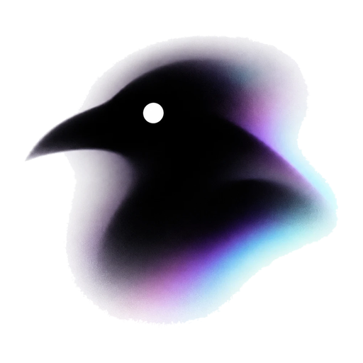

<p align="center">
  
</p>

<h1 align="center">FUCKINTERVIEW</h1>

<p align="center">
  A real-time voice interview copilot: it listens to the interviewer, draws on your resume and Q&A library, and puts a ready-to-speak answer on screen.
</p>

<p align="center">
  <strong>English</strong> · <a href="README.md">简体中文</a>
</p>

<p align="center">
  
  
  
  
</p>

---

FUCKINTERVIEW is a local-first desktop assistant for job interviews. It captures the interviewer's voice from system audio, transcribes it, and generates an answer grounded in your interview profile, Q&A library and terminology list — shown as text in real time. Your data, models and API keys never leave your machine.

## Installation

### Windows installer

Download the latest `FUCKINTERVIEW-Setup-<version>.exe` from [Releases](https://github.com/hu-qi-jia/FUCKINTERVIEW/releases) and run it. If no installer is published yet, build one with the instructions under “Run from source” below.

On first launch you can choose where data and model files are stored (or skip it and change these later in **Settings → General**). Then open **Settings → Model Configuration** and fill in your ASR / LLM API keys.

- Data lives in `%APPDATA%\FUCKINTERVIEW\data` by default and is kept when you uninstall
- System-audio capture uses the Windows loopback device and requires Windows 10 2004 or later
- Upgrading from the old “面试语音助手” app copies existing data into the new folder on first launch; the old folder is kept

### Run from source

Requires Python 3.11+ and Node.js 20+:

```bash
git clone https://github.com/hu-qi-jia/FUCKINTERVIEW.git
cd FUCKINTERVIEW

python -m venv .venv
.venv/Scripts/python -m pip install -r requirements.txt

npm --prefix web/client install
npm --prefix web/client run build

npm --prefix desktop install
npm --prefix desktop start
```

To use it in the browser only (without the desktop shell):

```bash
PYTHONUTF8=1 PYTHONIOENCODING=utf-8 .venv/Scripts/python.exe server.py
```

Then open <http://localhost:7860/>. On macOS / Linux, replace `.venv/Scripts/python` with `.venv/bin/python`.

Build the Windows installer yourself:

```bash
npm --prefix desktop run dist
```

The output is `desktop/dist/FUCKINTERVIEW-Setup-<version>.exe`.

## Tech stack

| Layer | Choice |
| --- | --- |
| Desktop | Electron 44 (frameless window, tray, system-audio loopback, capture protection) |
| Frontend | React 19 · TypeScript · Vite · Tailwind CSS · Pipecat React SDK |
| Backend | Python 3.12 · FastAPI · Pipecat voice pipeline (SmallWebRTC transport) |
| Voice | Silero VAD · Smart Turn v3 (local ONNX inference) |
| Model providers | ASR: Qwen / MiniMax / Deepgram / OpenAI Whisper<br />LLM: any OpenAI-compatible API / Qwen / Anthropic |
| Local retrieval | SQLite FTS5 + `BAAI/bge-small-zh-v1.5` embeddings (ONNX, no PyTorch) |

<p align="center"><sub>Built with Pipecat · © 2026 hu-qi-jia</sub></p>
